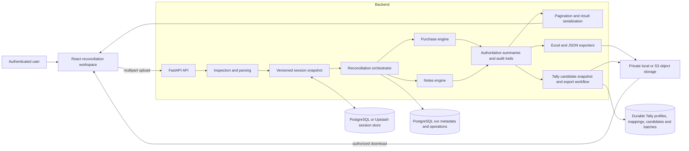
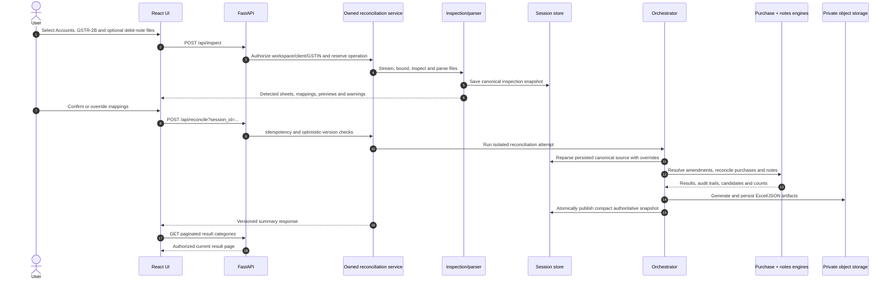
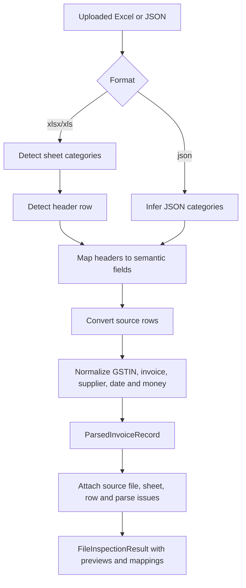
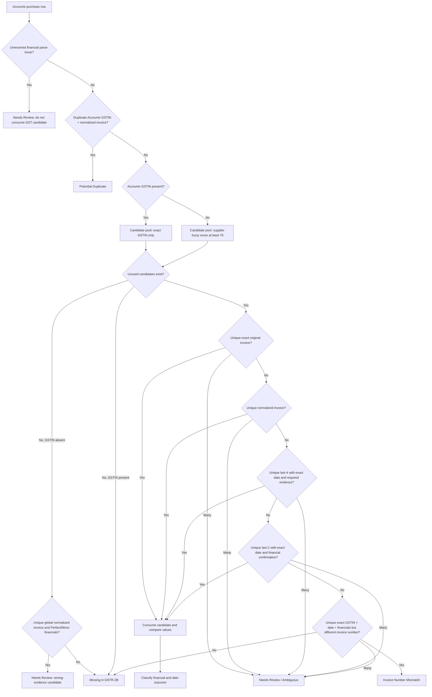
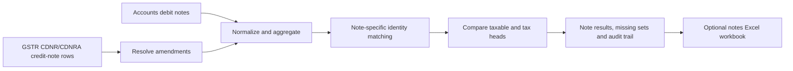
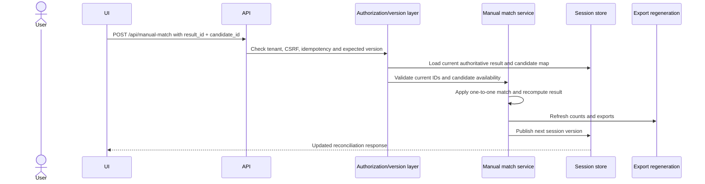
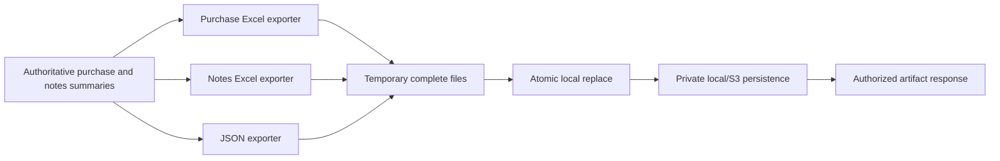
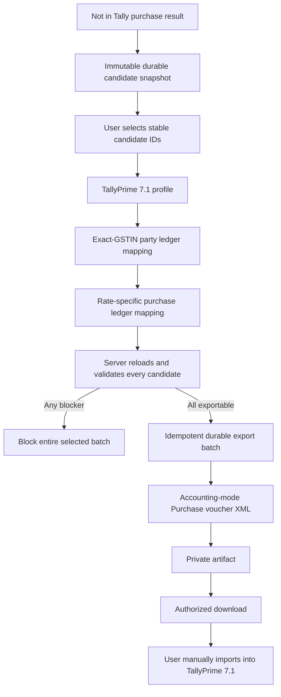

# Reconciliation Engine Architecture

Last verified against the repository implementation: 25 September 2026.

This document explains how the current GST reconciliation product works internally. It focuses on the implemented purchase and notes engines, their surrounding upload, persistence, API, UI and export workflows, and the invariants that must remain true when the engine changes.

The implementation is the source of truth. This document complements, but does not replace, `PROJECT_CONTEXT.md`, `CURRENT_ARCHITECTURE.md`, the root `README.md` and the regression tests.

## 1. Scope and responsibility

The reconciliation system compares accounting records against GSTR-2B data and produces traceable, per-document outcomes. Its current responsibilities are:

- purchase invoice reconciliation;
- debit-note versus GSTR CDNR/CDNRA reconciliation;
- mapping-assisted parsing of Excel or JSON sources;
- amendment and cancellation handling;
- bounded manual resolution of ambiguous matches;
- categorized, searchable and paginated results;
- purchase Excel, notes Excel and JSON exports;
- durable `Not in Tally` purchase candidates for TallyPrime 7.1 XML export.

The engine does **not** determine ITC eligibility, file GST returns, connect live to TallyPrime or automatically confirm whether Tally accepted an imported XML file.

## 2. System context



### Responsibility boundaries

| Layer | Owns | Must not own |
| --- | --- | --- |
| React frontend | File selection, mapping UI, result navigation, manual-match intent, export workflow presentation | Matching rules, accounting validation, tenant authorization |
| FastAPI routes | HTTP validation, authentication context, response schemas and status codes | Reimplementation of engine or exporter rules |
| Orchestrator | End-to-end session transformation and publication | UI rendering or direct client trust |
| Purchase/notes engines | Deterministic matching and classification | Object storage, HTTP or database authorization |
| Persistence services | Versioning, tenant ownership, operation receipts and durable snapshots | Altering reconciliation classifications |
| Export services | Projection of authoritative results into files | Rematching or silently changing source evidence |

## 3. Technology map

| Concern | Current technology |
| --- | --- |
| Frontend | React 19, TypeScript, Vite, Axios, Vitest and Testing Library |
| Backend API | Python, FastAPI, Pydantic and Uvicorn |
| Canonical domain models | Python dataclasses and enums |
| Excel input/output | `openpyxl` for `.xlsx`; `xlrd` for legacy `.xls` |
| Matching support | `rapidfuzz` for constrained supplier-name comparison |
| Database | PostgreSQL through SQLModel/SQLAlchemy; Alembic migrations |
| Working session state | PostgreSQL or Upstash Redis in production; local alternatives for development |
| Private artifacts | Local private storage in development or AWS S3 in production |
| Authentication | Supabase identity plus an Aligned HttpOnly application session; managed-account path also exists |
| Tests | Pytest for backend; Vitest and Testing Library for frontend |

Money is represented with `Decimal`, not binary floating point. Dates are canonical Python `date` values. Normalized identifiers and source provenance remain attached to the result so exports and reviews do not have to infer them again.

## 4. End-to-end lifecycle



The authenticated path uses operation receipts and isolated attempt state. A completed snapshot is published only after reconciliation and required artifact generation succeed. This prevents clients from observing a partially updated result set.

## 5. Upload, inspection and mapping

### 5.1 Transport safeguards

`backend/app/api/routes/inspection.py` accepts:

- one required Accounts file;
- one required GSTR file;
- one optional debit-notes file.

Supported formats are `.xls`, `.xlsx` and `.json`. Uploads are streamed in chunks and share a combined 25 MB limit. File extensions are checked, Excel containers are identified by content, uploaded names are reduced to metadata-only basenames, and temporary paths are generated beneath the controlled session directory.

### 5.2 Detection pipeline

The parser delegates structural interpretation to focused services:



Important services are:

- `sheet_detector.py` — semantic worksheet selection;
- `header_detector.py` — header-row discovery;
- `column_detector.py` — semantic column mapping;
- `normalizer.py` — GSTIN, invoice number, supplier name, date and monetary normalization;
- `file_parser.py` — row conversion and canonical inspection output.

### 5.3 Canonical record

`ParsedInvoiceRecord` is the common source representation. It preserves, among other fields:

- source side and sheet category;
- source sheet and row;
- supplier name and original/normalized GSTIN;
- original and normalized invoice/note number;
- invoice/note date;
- voucher and note direction;
- taxable value, gross/invoice total, IGST, CGST, SGST and cess;
- GST rate and place of supply;
- reverse-charge, amendment and cancellation evidence;
- financial parsing issues.

Invalid financial text is not silently converted into a trustworthy zero. The record carries a `FinancialParseIssue`, and automatic matching or export validation can block or route the document to review.

### 5.4 Mapping overrides

Inspection returns detected mappings and available source headers. When a user changes a mapping, the server reparses the persisted canonical sheet representation. The browser never supplies reconstructed financial records.

After inspection, raw instance-local uploads are deleted once normalized state and private source artifacts exist. Reconciliation later reparses the persisted inspection data, which also lets mapping overrides work across application instances when a shared session store is configured.

## 6. Orchestration and authoritative state

`backend/app/services/reconciliation_orchestrator.py` coordinates the workflow:

1. load the current session;
2. reparse Accounts, GSTR and optional debit-note inspection data;
3. apply mapping overrides to the appropriate selected sheets;
4. resolve B2B/B2BA amendments;
5. run purchase reconciliation;
6. resolve CDNR/CDNRA amendments;
7. run notes reconciliation;
8. assign opaque result and candidate IDs for manual review;
9. remove bulky raw dictionaries while retaining source evidence;
10. generate Excel and JSON files into temporary paths;
11. atomically replace and persist successful artifacts;
12. publish one compact authoritative session snapshot.

The orchestrator is intentionally separate from the matching engines. It handles lifecycle and artifacts; the engines handle business decisions.

## 7. Purchase reconciliation engine

The purchase implementation is in `backend/app/services/reconciliation_engine.py`.

### 7.1 Population preparation

The engine first creates the two active populations:

- Accounts rows with source `TALLY`, voucher type `PURCHASE` or `UNKNOWN`, and an invoice number;
- GSTR rows from semantic `B2B` or `B2BA` categories with purchase-compatible voucher types.

Explicitly cancelled records are separated before matching. If any GSTR row within an aggregate identity contains cancellation evidence, the complete invoice aggregate is removed from the active matching population and represented in cancelled-voucher output.

GSTR lines are aggregated by:

```text
(normalized supplier GSTIN, normalized invoice number, invoice date)
```

The aggregate sums taxable value, IGST, CGST, SGST and cess, retains invoice value where supplied, combines financial parsing issues, and keeps every source row.

### 7.2 Matching decision tree



### 7.3 Candidate selection rules

The order is deliberate and must not be casually rearranged.

| Priority | Method | Required evidence |
| --- | --- | --- |
| A | Exact invoice | Exact original invoice text within the allowed supplier pool; candidate must be unique |
| B | Normalized invoice | Equal normalized invoice identity; candidate must be unique |
| C | Last 4 | Suffix match plus exact date; missing-GSTIN supplier fallback also requires Perfect/Minor financial confirmation |
| D | Last 2 | Suffix match plus exact date and Perfect/Minor financial confirmation |
| E | Invoice-number mismatch | Exact GSTIN, exact date and exact taxable/IGST/CGST/SGST values; reciprocal Accounts signature must also be unique |

When otherwise-equal candidates remain, supplier-name similarity is used before exact invoice date as a discriminator. Multiple surviving candidates produce an ambiguous review result rather than an arbitrary match.

### 7.4 One-to-one consumption

An aggregated GSTR invoice has a `consumed` flag. A successful automatic or manual match consumes it, so it cannot satisfy a second Accounts invoice. After every Accounts row is processed, all unconsumed active GSTR aggregates become `Not in Tally` results.

### 7.5 Financial comparison and classification

For a matched pair, the engine calculates signed differences as:

```text
Accounts value - GSTR value
```

It compares taxable value, IGST, CGST and SGST. Gross total is compared with GSTR invoice value only when both sides actually supplied those fields.

The current status threshold is:

| Maximum absolute available difference | Status |
| --- | --- |
| Exactly `0.00` | Perfectly Matched |
| Greater than zero and at most `1.00` | Minor Rounding Difference |
| Greater than `1.00` | Major Difference |

Date mismatch is recorded independently, including the absolute day difference. Invoice-number mismatch is also a distinct classification produced only by the reciprocal-uniqueness rule above.

### 7.6 Purchase outcomes

`ReconciliationStatus` currently includes:

- `Perfectly Matched`;
- `Minor Rounding Difference`;
- `Major Difference`;
- `Missing in GSTR-2B`;
- `Not in Tally`;
- `Needs Review / Ambiguous`;
- `Potential Duplicate`;
- `Invoice Number Mismatch`;
- `Taxable Value Missing`.

Cancelled vouchers are maintained as a separate population with source-side, source-system and cancellation evidence. Date mismatch can be presented as an attention category even when the underlying matched result has another financial status.

## 8. Auditability and provenance

Every `ReconciliationResult` carries an `AuditTrail`. It records:

- Accounts and GSTR source rows;
- original and normalized document identifiers;
- supplier/GSTIN selection evidence;
- match method;
- taxable, gross-total and tax-head comparisons;
- candidate count and bounded review candidates;
- final status and human-readable explanation.

The reporting layer calls `refresh_source_values()` so displayed values come from actual matched sides. An ambiguous candidate is not treated as a matched GSTR side until a user explicitly confirms it.

This provenance feeds the result drawer, paginated API, Excel evidence columns, JSON export, manual matching and durable Tally candidate snapshots.

## 9. Notes reconciliation

Notes are implemented separately in `backend/app/services/notes_reconciliation_engine.py` because their accounting semantics differ from purchases.



The notes engine:

- aggregates GSTR credit-note lines;
- preserves note direction and original/amended note metadata;
- uses GSTIN or constrained supplier-name selection;
- tries exact, normalized and bounded suffix note-number strategies;
- maintains one-to-one consumption and ambiguity handling;
- produces its own summary and missing-note populations.

Purchase fallbacks must not be copied into notes without proving that note direction, amendment behavior, duplicate handling and missing-record semantics remain correct.

## 10. Manual matching

Manual matching resolves a server-generated ambiguous result; it is not a client-side override of arbitrary data.



Opaque result and candidate IDs are assigned after the automatic engines finish. The authoritative candidates remain inside the result audit trail; the separate map only records which generated references are allowed. A stale, unknown or already-consumed candidate fails rather than mutating the wrong result.

## 11. Persistence, isolation and versioning

### 11.1 Durable metadata versus expiring detail

The persistence model intentionally separates:

- durable run ownership and lifecycle in `reconciliation_runs`;
- idempotent mutation receipts in `run_operations`;
- detailed, versioned working state in the configured session store;
- private source and report artifacts in object storage;
- durable Tally export candidates, configuration, batches and items in PostgreSQL.

Detailed reconciliation state expires according to the session-store TTL. Run metadata and Tally export history remain durable.

### 11.2 Owned reconciliation mutations

`backend/app/services/owned_reconciliation.py` is the authenticated mutation boundary. It:

- authorizes workspace/client/GSTIN access;
- reserves an idempotent operation key and request fingerprint;
- checks the expected result version;
- computes in isolated scratch/session state;
- publishes only a complete snapshot;
- records finalized, failed or unresolved operation state;
- supports guarded recovery.

OWNER and ADMIN access differs from assigned ACCOUNTANT access. Inactive clients, GSTINs, assignments or memberships fail closed.

### 11.3 Session backends

`session_store.py` supports in-memory and JSON stores for limited development scenarios, plus PostgreSQL and Upstash Redis. Production requires a shared supported store so separate API processes observe the same authoritative session.

## 12. API and frontend result flow

### 12.1 Core routes

| Route | Purpose |
| --- | --- |
| `POST /api/inspect` | Upload, inspect and persist canonical input state |
| `POST /api/reconcile?session_id=...` | Apply mappings and run purchase plus notes reconciliation |
| `GET /api/session/{session_id}` | Return session readiness metadata |
| `GET /api/session/{session_id}/results` | Search, sort and paginate a current category |
| `POST /api/manual-match?session_id=...` | Confirm one allowed ambiguous candidate |
| `GET /api/export/{session_id}/excel` | Download purchase workbook |
| `GET /api/export/{session_id}/notes/excel` | Download notes workbook when present |
| `GET /api/export/{session_id}/json` | Download bounded structured JSON |

Authenticated routes derive tenant context through middleware and `owned_reconciliation`; possession of a session ID alone is not authorization.

### 12.2 Result projection

`result_pagination.py` converts the authoritative dataclass results into UI-safe dictionaries, applies category aliases, search and sorting, and returns bounded pages. The frontend does not download the complete result population merely to filter it.

`ReconciliationWorkspace.tsx` owns the workflow state. `ResultsDashboard.tsx` coordinates summary cards, purchase/notes tabs, result categories, detail drawers, manual review entry points, standard exports and the Tally workflow. Focused table components render results but do not implement match logic.

## 13. Export architecture

### 13.1 Reconciliation files



Exports are projections of the current authoritative summaries. They do not rerun matching. Temporary files are completed before replacement, then persisted through `object_storage.persist_artifact`.

The JSON download is capped at 3.5 MB in the current pilot transport. Larger datasets must use the Excel report.

### 13.2 Tally Export V1 handoff

Only purchase invoices in the durable `Not in Tally` population enter the current Tally export path.



Generation revalidates durable candidates and resolved mappings immediately before rendering. Supported V1 covers CGST/SGST, IGST and multi-rate Purchase vouchers. RCM, cess, amendments, cancellations and unresolved financial structures are blocked where required.

An important offline boundary remains: Aligned stores the ledger names the user confirms, but it cannot inspect the ledgers inside a local Tally company. A saved mapping therefore proves only that Aligned has a mapping, not that the named Tally master exists. The Tally company and every party, purchase and tax ledger must already exist with exactly matching names, or Tally will parse the XML and then report `Referenced master is missing` without creating the affected vouchers.

## 14. Failure behavior

| Failure point | System behavior |
| --- | --- |
| Unsupported or oversized upload | Reject request before reconciliation |
| Unreadable source | Delete failed session attempt and return a safe validation error |
| Invalid mapped money | Preserve parse issue; prevent unsafe automatic interpretation |
| Multiple viable candidates | Return review/ambiguous result; do not consume a candidate |
| Reused candidate | Reject stale/manual mutation |
| Version or idempotency conflict | Return conflict rather than double-apply |
| Export generation failure | Do not publish a partial authoritative result snapshot |
| Missing private artifact | Regenerate supported reconciliation exports when possible or fail safely |
| Tally validation blocker | Block the complete selected Tally batch |
| Missing local Tally master | Tally rejects affected vouchers after offline import; Aligned cannot observe this automatically |

## 15. Tests and verification map

The main regression groups are:

| Area | Representative tests |
| --- | --- |
| Parsing and normalization | `test_file_parser.py`, `test_normalizer.py` |
| Purchase business rules | `test_reconciliation.py`, `test_adversarial_matching.py` |
| Notes | `test_notes_reconciliation.py` |
| Result fidelity and provenance | `test_result_pagination.py`, `test_record_provenance.py` |
| Manual matching | `test_manual_match_integrity.py` |
| Owned mutation and persistence | `test_owned_reconciliation.py`, database schema tests |
| Excel and JSON exports | `test_exporters.py` |
| Tally contract and validation | `test_tally_export_contract.py`, `test_tally_export_validation.py` |
| Tally XML and real-compatibility evidence | `test_tally_voucher_exporter.py`, `test_tally_fixture_compatibility.py` |
| Tally HTTP workflow | `test_tally_export_api.py`, configuration tests |
| Frontend result and Tally flows | `ReconciliationWorkspace.test.tsx`, result tests, `TallyExportWorkflow.test.tsx`, `tallyExportApi.test.ts` |

Matching changes should be tested against both normal and adversarial populations. A new match strategy needs evidence that it does not introduce cross-GSTIN pairing, reuse a consumed candidate, hide parse failures, weaken reciprocal uniqueness or change notes behavior unintentionally.

## 16. Key invariants

1. GSTIN-present Accounts rows only use the exact GSTIN candidate pool.
2. Supplier-name fallback is used only when Accounts GSTIN is missing.
3. Weak suffix matching requires exact date and the documented financial evidence.
4. One GSTR aggregate may be consumed at most once.
5. Ambiguity must remain visible; never select an arbitrary candidate.
6. Invalid financial input must not be treated as a valid zero.
7. Purchase and notes semantics remain separate.
8. Cancellation partitioning happens before active matching.
9. Source rows and explanations remain available for audit and export.
10. The browser cannot submit authoritative financial rows or accounting decisions.
11. Tenant authorization precedes run, session and artifact access.
12. Owned mutations preserve idempotency and optimistic version checks.
13. Exports derive from the published authoritative summary.
14. Tally generation reloads durable candidates and revalidates on the server.
15. Private artifact references remain tenant/run scoped.

## 17. Code map

| Concern | Primary implementation |
| --- | --- |
| Upload endpoint | `backend/app/api/routes/inspection.py` |
| File parsing | `backend/app/services/file_parser.py` |
| Detection | `sheet_detector.py`, `header_detector.py`, `column_detector.py` |
| Normalization | `backend/app/services/normalizer.py` |
| Amendment resolution | `backend/app/services/amendment_resolver.py` |
| Cancellation handling | `backend/app/services/cancellation_detector.py` |
| Orchestration | `backend/app/services/reconciliation_orchestrator.py` |
| Purchase engine | `backend/app/services/reconciliation_engine.py` |
| Notes engine | `backend/app/services/notes_reconciliation_engine.py` |
| Manual match | `backend/app/services/manual_match_service.py` |
| Result paging | `backend/app/services/result_pagination.py` |
| Owned mutation boundary | `backend/app/services/owned_reconciliation.py` |
| Session persistence | `backend/app/services/session_store.py` |
| Purchase/notes Excel | `backend/app/services/excel_exporter.py` |
| JSON report | `backend/app/services/json_exporter.py` |
| Private artifacts | `backend/app/services/object_storage.py` |
| Tally candidate contract | `backend/app/services/tally_export_contract.py` |
| Durable Tally candidates | `backend/app/services/tally_export_candidate_service.py` |
| Tally validation | `backend/app/services/tally_export_validation_service.py` |
| Tally workflow/API service | `backend/app/services/tally_export_workflow_service.py` |
| Tally XML | `backend/app/services/tally_voucher_exporter.py` |
| Frontend workspace | `frontend/src/workspace/ReconciliationWorkspace.tsx` |
| Frontend results | `frontend/src/components/results/ResultsDashboard.tsx` and related tables |
| Frontend Tally flow | `frontend/src/components/tally-export/` |

## 18. Safe change procedure

Before changing reconciliation behavior:

1. identify the exact engine stage and invariant affected;
2. inspect source provenance and financial parse behavior;
3. add a focused regression case plus an adversarial counterexample;
4. prove one-to-one consumption and ambiguity behavior remain correct;
5. verify purchase and notes independently;
6. run exporter and pagination tests when result shape changes;
7. run owned-reconciliation tests when publication or mutation changes;
8. run Tally contract/API tests when `Not in Tally` candidate data changes;
9. update this document only after implementation and tests agree.

Do not broaden matching merely to improve the apparent match rate. A visible missing or ambiguous record is safer than a confident but incorrect accounting match.
